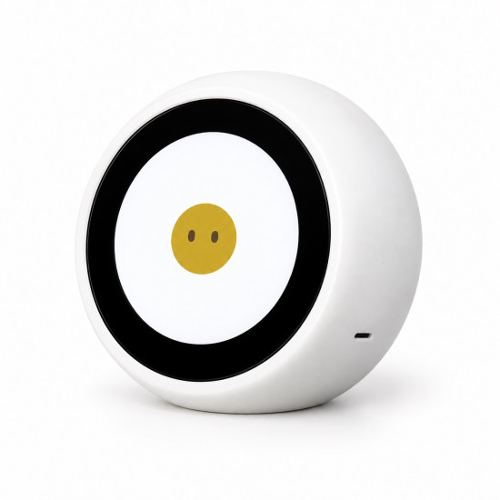

Kompaktní deska ESP32-S3 N16R8 v bílém kulatém krytu spojuje displej, mikrofon a reproduktor. Hodí se pro hlasové asistenty, stolní hodiny nebo zobrazení stavu chytré domácnosti.

## Parametry

| Součást | Specifikace |
| --- | --- |
| Procesor | ESP32-S3, dvě jádra Xtensa LX7, až 240 MHz |
| Paměť | 16 MB flash, 8 MB PSRAM |
| Displej | IPS 1,28″, 240 × 240 px, řadič GC9A01 přes SPI |
| Zvuk | Digitální I2S mikrofon a I2S zesilovač s reproduktorem |
| Připojení | Wi-Fi 2,4 GHz, Bluetooth 5 LE |
| Napájení a programování | USB-C, 5 V |

Displej nemá dotykovou vrstvu a zařízení nemá baterii. USB-C kabel ani napájecí adaptér nejsou součástí balení; k nahrávání firmwaru je potřeba datový kabel.

## Vývoj

Programování je možné v Arduino / PlatformIO nebo ESP-IDF. Pájeníčko zveřejnilo ověřené zapojení, pinout, návod k sestavení a ukázkový firmware v [repozitáři xiaozhi-esp32s3-128-demo](https://github.com/Pajenicko/xiaozhi-esp32s3-128-demo). Pro použití s xiaozhi-esp32 je nutné upravit konfiguraci desky.

## Související

- [M5Stack StopWatch](../m5stack-stopwatch) — přenosná deska s dotykovým AMOLED displejem a baterií.

## Sources

- [ESP32-S3 N16R8 s displejem, mikrofonem a reproduktorem — Pájeníčko](https://pajenicko.cz/vyvojova-deska-esp32-s3-n16r8-kulaty-ips-displej-1.28-mikrofon-a-reproduktor) — parametry, omezení a vývojové podklady (ověřeno 2026-11-25).
