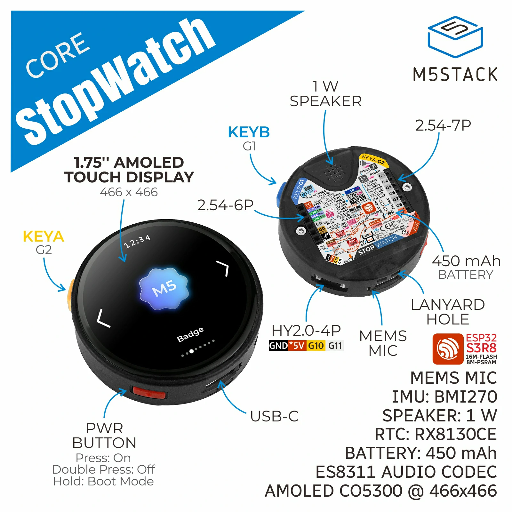

M5Stack StopWatch (SKU C152) je kulatá vývojová deska pro přenosné ovladače, elektronické jmenovky a malé IoT terminály. Obsahuje mikrofon, reproduktor, vibrační motor a baterii.

## Parametry

| Součást | Specifikace |
| --- | --- |
| Procesor a paměť | ESP32-S3R8, 240 MHz, 16 MB flash, 8 MB PSRAM |
| Displej | Dotykový AMOLED 1,75″, 466 × 466 px, CO5300 |
| Připojení | Wi-Fi 2,4 GHz |
| Zvuk | MEMS mikrofon, kodek ES8311, reproduktor 1 W |
| Senzory a čas | Šestiosá IMU BMI270, RTC RX8130CE |
| Ovládání | Dvě programovatelná tlačítka, tlačítko napájení, vibrace |
| Napájení | Baterie 450 mAh, USB-C 5 V, řízení M5PM1 |
| Rozšíření | HY2.0-4P a zadní rozšiřující sběrnice |
| Rozměry a hmotnost | 52 × 52 × 15,5 mm, 39 g |

## Vývoj

Dokumentace obsahuje návody pro Arduino, UiFlow2 a hlasového asistenta Xiaozhi přes M5Burner, konfiguraci PlatformIO i tovární firmware pro ESP-IDF.

:::caution[Označení napájecího pinu]
U některých kusů verze v1.0 je pin chybně označený jako BAT, přestože jde o vstup 5 V. Baterii k němu nepřipojujte. Verze v1.0.1 má tento pin skutečně zapojený jako BAT; před zapojením ověřte verzi hardwaru.
:::

## Související

- [ESP32-S3 N16R8 s kulatým displejem](../esp32-s3-n16r8) — deska s IPS displejem a zvukem, bez baterie a dotyku.

## Sources

- [M5Stack StopWatch — oficiální dokumentace](https://docs.m5stack.com/en/core/StopWatch) — parametry, fotografie, vývojové návody a rozdíly verzí (ověřeno 2026-11-25).
